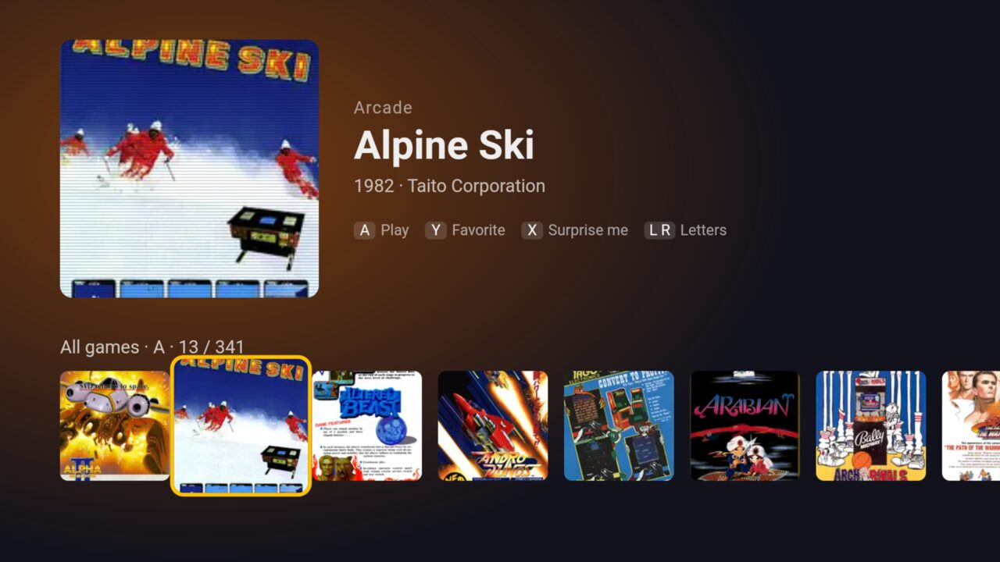

# Retro Games for Fire TV

A small native retro-game app for Amazon Fire TV and Android TV boxes. It plays **NES, SNES,
Master System, Game Boy and arcade (MAME)** at a full 60 fps on a cheap Fire TV Stick, with games
streamed on demand from your own NAS.

- **Console carousel, then a game shelf:** a big hero for the selected game (year, developer, players)
  over a row of box art, with "Continue playing" and "Favorites" rows. It works with the remote or a
  Bluetooth controller.
- **Games download from an SMB share** (a NAS) the first time you play them, then stay on the TV.
- **Save states, in-game battery saves, and "continue where you left off".**
- **About 12 MB** for the whole APK, using libretro emulator cores and a tiny C frontend.
- **Built with nothing but the Android command-line tools:** no Gradle, no Android Studio.

No games are included. Bring your own (see [Games](#games)).



## How it performs

On a Fire TV Stick with a 1.4 GHz quad-core ARM chip, 32-bit Android 7.1 and 4K output:

| Game | Frame rate | Emulation time per frame (budget 16.7 ms) |
|---|---|---|
| NES (Nova the Squirrel) | 60 fps | ~6 ms |
| SNES (Super Punch-Out!!) | 60 fps | 3–5 ms |

Web emulators in the TV's browser engine topped out at 45–50 fps with crackling audio on the same
device; see [Lessons learned](#lessons-learned).

## Setup

You need a Mac (the scripts use Homebrew paths and macOS's `osascript` to mount the share; on Linux,
set `ANDROID_HOME` and `JAVA_HOME` and mount the share yourself), a Fire TV or Android TV device,
and an SMB share with guest read access.

### 1. Tools

```sh
brew install --cask android-commandlinetools
brew install openjdk@21 imagemagick
export JAVA_HOME=/opt/homebrew/opt/openjdk@21
sdkmanager "platform-tools" "build-tools;34.0.0" "platforms;android-34" "ndk;27.2.12479018"
```

Python 3 (preinstalled on macOS) runs the catalog script.

### 2. The code

```sh
git clone --recursive <this repository>
```

The emulator cores are git submodules in `retro/third_party/`. If you cloned without `--recursive`,
run `git submodule update --init`.

### 3. Your games on the NAS

Put zipped ROMs in one folder per console on the share, with these folder names:

```
<share>/ROMS/Nintendo - NES/
<share>/ROMS/Nintendo - SNES/
<share>/ROMS/Sega - Master System/
<share>/ROMS/Sega - Mega Drive/        (supported, not yet tested)
<share>/ROMS/Nintendo - Game Boy/
<share>/ROMS/Arcade - MAME Legacy/     (MAME 0.37b5 sets, see Arcade below)
```

- **Names:** No-Intro file names (`Super Mario World (USA).zip`) give the best titles and box-art
  matches.
- **Guest access:** the share must allow guest (anonymous) read access, since the app has no login.
- **The Mac** needs the share mounted, so the catalog script can scan it.

### 4. The TV

1. Turn on developer mode: Settings → My Fire TV → About, then click the device name 7 times.
2. Turn on Developer Options → **ADB debugging**.
3. Note the TV's IP address (About → Network).

### 5. Configure and build

```sh
cd retro
cp local.conf.example local.conf    # then set your TV and NAS addresses in it
./update.sh
```

`update.sh` runs the whole pipeline:
1. Mounts the share if needed.
2. Scans your ROMs and fetches box art (`tools/catalog.py`).
3. Builds the APK (`build.sh`).
4. Installs it on the TV over ADB. The first time, accept the "Allow USB debugging" prompt on the TV.

**Run it again whenever you add games.** Saves and downloaded games on the TV are kept.

**Keep `retro/retro.keystore`,** which the first build creates. It signs your APK. Without it,
updates can't install over the existing app, and uninstalling to start over loses your saves.

## Using it

- **Consoles:** left and right choose a console, OK opens its shelf, Back returns.
- **Shelf:** left and right move through the games, up and down switch rows, OK plays.

  | Action | Controller | Remote |
  |---|---|---|
  | Favorite (★) | Y | Menu |
  | Surprise me (random game) | X | — |
  | Previous / next letter | L / R | Rewind / Fast-forward |
- **Starting a game:** the first time, it downloads from the NAS ("Downloading…").
- **Pause menu:** Back (remote or controller), the controller's Guide/Home button, or Start + Select
  together. It offers Resume, Save state, Load state, Restart game and Quit.
- **Continuing:** quitting, or leaving with Home, remembers your spot. The game continues there next
  time, and its tile shows a "▶ Continue" badge.
- **Controller face buttons go by position, SNES-style:** bottom = B, right = A, left = Y, top = X.
  L1/L2 = L, R1/R2 = R. Cores map these to their console (NES A/B, Master System 1/2).
- **Movement:** the D-pad, hat, and left stick all work.
- **Remote:** OK = A, Play/Pause = Start, Menu = Select.
- **Arcade:** Select inserts a coin, Start starts.
- **The faint counter** in the top-right corner shows fps, emulation time per frame, and audio gaps.

## How it works

```
MenuActivity (WebView: assets/menu.html + games.js + covers/)
   │ console carousel (photos) → game shelf (hero + one row of 9 cover slots that shift as you move)
   │ Bridge.play(core, host, share, path, key, title, raw, deps)      (window.Android in JS)
   ▼
GameActivity
   ├─ Loader thread: ROM cached on the TV? else download it from the NAS with Smb
   │                 → unzip (consoles) or keep the zip plus parent/BIOS zips (arcade)
   │                 → nativeLoad(lib<core>.so, rom) → load battery save → load .auto state if present
   ├─ emulator thread: nativeFrame(buttons) → audio to a blocking AudioTrack (paces the game)
   └─ pause menu: Resume, Save state, Load state, Restart game, Quit
          │
libfrontend.so (app/jni/frontend.c): a minimal libretro frontend
   ├─ dlopen()s the core: libfceumm.so (NES), libsnes9x2005.so (SNES), libgenesis_plus_gx.so (Sega),
   │  libgambatte.so (Game Boy), libmame2000.so (arcade)
   ├─ video: copies frames straight into the Surface (ANativeWindow, RGB565, integer upscale, no OpenGL)
   └─ save states (retro_serialize), battery saves (RETRO_MEMORY_SAVE_RAM)
```

| Path (under `retro/`) | What it is |
|---|---|
| [`app/src/com/example/retro/`](retro/app/src/com/example/retro) | `MenuActivity` (the WebView menu), `Bridge` (JS → app), `GameActivity` (game screen, input, audio, pause menu, saves), `Loader` (downloads), `Smb` (SMB2 client) |
| [`app/jni/frontend.c`](retro/app/jni/frontend.c) | The libretro frontend (about 320 lines of C) |
| [`app/assets/menu.html`](retro/app/assets/menu.html) | The menu UI, with D-pad navigation in JS |
| `app/assets/games.js`, `covers/`, `consoles/` | Generated by `tools/catalog.py` from your ROMs; not in git |
| [`tools/catalog.py`](retro/tools/catalog.py) | Scans the share, builds the game list, fetches art |
| [`build.sh`](retro/build.sh), [`update.sh`](retro/update.sh) | Build, and the full scan → build → install pipeline |
| [`third_party/`](retro/third_party) | libretro cores (git submodules) |

### Saves and downloads (on the TV, in app-private storage)

| File | What it is |
|---|---|
| `files/saves/<console>/<game>.srm` | The in-game battery save. Loaded at start, written on Save state, Quit and leaving the app. |
| `files/saves/<console>/<game>.state` | The manual "Save state" slot (one per game). |
| `files/saves/<console>/<game>.auto` | Where you left off. Written on Quit and when the app is paused (Home, TV sleep). Loaded automatically at launch. "Restart game" deletes it. |
| `files/roms/<console>/...` | Downloaded games. |

Reinstalling (`adb install -r`) keeps all of these. Uninstalling deletes them.

### Building

- `build.sh` compiles the frontend and each core with `ndk-build`, using **each core's own upstream
  `jni/Android.mk`**, and renames its `libretro.so` to `lib<core>.so`.
- Native code compiles in a copy under `$TMPDIR/retrogames-native`, because `ndk-build` breaks on
  spaces in paths. rsync keeps it incremental.
- APK steps: `aapt2 compile/link` → `javac -source 8 -target 8` → `jar` → `d8` → add `classes.dex`
  and `lib/armeabi-v7a/*.so` → `zipalign -p` → `apksigner`.
- **Target:** `armeabi-v7a`, minSdk 22. Fire TV Sticks run 32-bit Android even on 64-bit chips.

### Catalog: tools/catalog.py

`python3 tools/catalog.py ROMS_DIR NAS_HOST [SHARE]` (`update.sh` passes these from `local.conf`)

- **Console folders:** the `CONSOLES` list maps share folders to console ids, cores, thumbnail
  systems and console photos. Folders not in the list are ignored.
- **Titles:** No-Intro names are cleaned up (`Adventures of Batman & Robin, The (USA)` →
  `The Adventures of Batman & Robin`).
- **Box art:** fetched from [libretro-thumbnails](https://github.com/libretro-thumbnails)
  (`thumbnails.libretro.com/<system>/Named_Boxarts/<name>.png`), then shrunk to 160×160 WebP
  (about 6 KB each).
  - If the exact name has no art, it falls back to the console's art index, matching on the cleaned
    title and preferring USA > World > Europe > Japan.
  - Fan translations often have no art. They show a tile with the title.
- **Console photos:** Wikimedia Commons files, cut out (white backgrounds cleared from the corners),
  saved as `app/assets/consoles/<id>.webp`, and credited in `app/assets/consoles/CREDITS.txt`.
- **Year, developer and players:** from [libretro-database](https://github.com/libretro/libretro-database)
  metadata (`releaseyear`, `developer`, `maxusers`), matched by the CRC of the ROM inside each zip,
  then by name. Arcade uses year and manufacturer from MAME's list.
- **Safety:** if it finds no games (usually because the share isn't mounted), it stops instead of
  wiping the list and covers.
- **Output:** `games.js` contains `SOURCE` (NAS host, share, ROM dir), `CONSOLES`, and `GAMES`
  (`[console, file, title, key, hasCover, (arcade) zips it also needs or 0, "year · developer · players"]`).
  The key names the cover, the downloaded ROM, and the saves.

### Arcade (MAME)

- **The set:** the arcade folder must hold **MAME 0.37b5** sets (zip contents look like
  `kof98_c1.rom`), which is what the **MAME 2000** core runs. MAME 2000 is the lightest libretro MAME
  core, a good fit for TV hardware.
- **Titles and dependencies** come from the core's `metadata/MAME 0.37b5 XML.dat`: each set's title,
  its parent (`cloneof`), and its BIOS (`romof` without `cloneof`, e.g. `neogeo`).
- **The catalog checks every zip** against that list (by CRC, including parent and BIOS zips) and
  leaves out sets that can't run, printing why: a missing `neogeo.zip`, or a zip from another MAME
  version.
- **On the TV,** arcade zips stay zipped under their exact set name (`raw` in `CONSOLES`), with
  their parent and BIOS zips downloaded next to them. They're streamed to disk, since Neo Geo zips
  reach 40 MB.
- **Art:** arcade box art (flyers) is sparse, so `Named_Snaps` (screenshots) back it up.
- **Screen:** vertical games come out upright; MAME 2000 rotates them itself and reports a 3:4 shape.
- **Save states** depend on MAME 2000's limited support and may not work for every game.

### Adding a console

1. Add its libretro core as a submodule in `retro/third_party/`
   (`git submodule add <url> retro/third_party/<name>`). It needs an Android build file (most cores
   have `jni/Android.mk`). Prefer light cores for TV hardware, e.g. `gpsp` for GBA.
2. Add an `ndk <name> third_party/<name> <folder holding jni/> retro <name>` line to `build.sh`.
3. Add the console to `CONSOLES` in `tools/catalog.py`: share folder, id, name, color, core, its
   libretro-thumbnails system name, and a Wikimedia Commons `photo` with its credit.
4. If its ROMs use new extensions, add them to `EXTS`. The extension of the file inside the zip is
   kept, because some cores tell systems apart by extension.
5. Run `update.sh`.

### Smb.java

This is a minimal read-only SMB2 client (dialects 2.0.2, 2.1 and 3.0), written instead of using
jcifs or smbj, which pull in large dependencies.
- **Login:** anonymous NTLM. Guest-enabled shares accept it, and nothing is signed.
- **Reading:** tree connect, CREATE, then READ in 64 KB chunks (one credit each), then CLOSE.
- **No directory listing:** the catalog is built on the Mac.

Test it from the Mac: `retro/tools/smbtest.sh <nas-ip> <share> "ROMS/Nintendo - NES/<file>.zip"`.
On a home network, login took 0.2 s and a 685 KB zip downloaded in 0.66 s.

### Debugging

- `adb logcat -s Retro` shows the core's log and one line per second with fps, emulation ms per
  frame, and audio gaps.
- `adb shell screencap -p > shot.png` takes a screenshot.
  - `adb shell screenrecord` doesn't capture gameplay (see below).

## Lessons learned

**Why native, not web emulators.**
- The first version wrapped a website running EmulatorJS (WebAssembly) in a WebView. The Fire TV
  reports a device pixel ratio of 4, so EmulatorJS rendered at full 4K and ran at 24 fps. Forcing
  `devicePixelRatio = 1` (960×540) got it to about 54 fps.
- It still topped out at 45–50 fps with stuttering audio. A CPU profile showed the single main thread
  saturated by WebAssembly emulation.
- Threading was impossible, because the Fire TV's WebView has no `SharedArrayBuffer`, even with
  COOP/COEP headers.
- The same libretro cores compiled natively use a third of the frame budget.

**Build quirks.**
- **d8 (build-tools 34) crashes** with a `NullPointerException` on nested or anonymous classes
  compiled by JDK 21's javac. Use only top-level classes, and have activities implement listener
  interfaces themselves. That's why `Loader` and `Bridge` are separate files.
- **Spaces in paths break `ndk-build`.** Native code builds under `$TMPDIR`.

**Fire TV behavior.**
- **Fire OS doesn't let apps change the display resolution.** `Display.getSupportedModes()` only
  returns the current mode, so `preferredDisplayModeId` can't switch a 4K TV to 1080p. Only the user
  can, in Settings → Display & Sounds → Display → Video Resolution.
- **Screen recordings miss gameplay.** `adb shell screenrecord` only captures the app's normal
  window, not the separate SurfaceView layer the game is drawn on. A TextureView would fix that.

**Emulation details.**
- **Audio clock drift:** consoles run at, e.g., 60.1 Hz while the TV refreshes at 60.0 Hz. The
  AudioTrack rate is set to `core_rate × display_hz / core_fps`, and the playback rate is nudged by up
  to ±0.5% to keep about 4 frames of audio queued (like RetroArch's dynamic rate control). Without
  this, the audio slowly runs dry and crackles.
- **Short taps** (and `adb shell input keyevent`) go down and up between two frames. Presses are
  latched for one frame so the game sees them.
- **Many controllers send Back** for a button, so Back from any source opens the pause menu instead
  of acting as a game button.
- **Screen shape:** home consoles are shown 4:3, like on a CRT. Handhelds and vertical arcade games
  use the shape their core reports (anything narrower than 1.15:1).

**Working on this with an AI agent.** A command sandbox may block local network access. If
`adb`, the SMB test, or the catalog fails against your LAN with "no devices" or connection errors,
run those commands outside the sandbox.

## Games

No ROMs are included, and none should ever be committed (`.gitignore` blocks the usual extensions).
Use games you're entitled to use, for example dumps of cartridges you own. The app only downloads
from your own share.

For testing without commercial games, `nes/tools/get_roms.sh` downloads 10 freely licensed homebrew
NES games from their authors' GitHub releases, and records their licenses.

## Repository layout

| Folder | What it is |
|---|---|
| [`retro/`](retro) | **Retro Games**, the app described above |
| [`nes/`](nes) | The first native prototype: fceumm compiled into one library with a JNI frontend, playing ROMs bundled in the APK (`nes/tools/get_roms.sh` fetches the homebrew set) |
| [`snes/`](snes) | The same prototype with snes9x2005 (put your own `.sfc` files in `snes/app/assets/roms/`) |

The prototypes build with their own `build.sh` and use the cores in `retro/third_party/`.

## Ideas

- List ROMs from the share at runtime (SMB QUERY_DIRECTORY) and fetch covers on the TV, so new games
  appear without a rebuild.
- More save slots, and screenshots on save states.
- GBA (the `gpsp` core).
- N64: a Fire TV's GPU (e.g. Mali-T820) could probably run lighter games, but N64 cores need
  OpenGL ES, which this frontend doesn't have.
- A TextureView option, so screen recordings capture gameplay.

## License

This project's code is MIT licensed; see [LICENSE](LICENSE). The emulator cores keep their own
licenses: two are GPL-2.0, and three are **non-commercial only**. Details are in
[THIRD_PARTY.md](THIRD_PARTY.md). Sharing a build for free is fine; selling it isn't.
